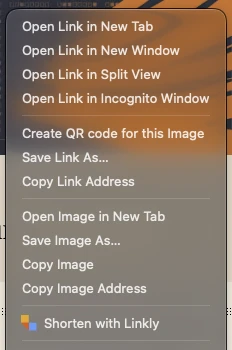

# Linkly Browser Extension

**Create trackable short links instantly from any webpage.** The official Linkly browser extension for Chrome, Firefox, and Safari makes link tracking and URL shortening effortless.

[](https://chrome.google.com/webstore/detail/linkly-for-google-chrome/eafdoeojplandfjbmjkglljhlckoajcg)
[](https://addons.mozilla.org/en-GB/firefox/addon/linkly/)
[](https://apps.apple.com/)

---

## Features

- **One-Click Link Creation** - Turn any webpage into a trackable Linkly link instantly
- **Right-Click to Shorten** - Right-click any link, or highlight a plain-text URL and right-click it, and choose **Shorten with Linkly**
- **Click Tracking & Analytics** - Monitor link performance with detailed analytics
- **Custom URL Shortening** - Create branded short links on the fly
- **Cross-Browser Support** - Available for Chrome, Firefox, and Safari
- **Privacy-Focused** - Only accesses the current tab URL when you click the button
- **Lightweight & Fast** - Minimal permissions, maximum performance

## Installation

### Chrome

1. Visit the [Chrome Web Store](https://chrome.google.com/webstore/detail/linkly-for-google-chrome/eafdoeojplandfjbmjkglljhlckoajcg)
2. Click **Add to Chrome**
3. Sign in to your [Linkly account](https://linklyhq.com)
4. Click the Linkly icon to start creating tracked links

### Firefox

1. Visit [Firefox Add-ons](https://addons.mozilla.org/en-GB/firefox/addon/linkly/)
2. Click **Add to Firefox**
3. Sign in to your [Linkly account](https://linklyhq.com)
4. Click the Linkly icon to start creating tracked links

### Safari

1. Download from the [Mac App Store](https://apps.apple.com/)
2. Open the Linkly app from Applications
3. Enable the extension in **Safari → Settings → Extensions**
4. Sign in to your [Linkly account](https://linklyhq.com)
5. Click the Linkly icon to start creating tracked links

## How to Use

1. **Navigate** to any webpage you want to track
2. **Click** the Linkly extension icon in your browser toolbar
3. **Create** your trackable link with custom settings
4. **Share** and monitor performance via your Linkly dashboard

To shorten a link that is on a page rather than the page itself, right-click it and choose **Shorten with Linkly**. If the URL is plain text rather than a hyperlink (for example in an AI chat reply), highlight it and right-click the selection instead.



## Permissions & Privacy

The Linkly extension requests minimal permissions:

- **Active Tab** - Only accesses the current tab's URL when you click the button
- **Context Menus** - Adds the "Shorten with Linkly" right-click item; the extension only receives the link, or the highlighted text, you right-click and choose it on
- **No Background Tracking** - The extension does not track your browsing history
- **No Data Collection** - We only process the URL you choose to shorten

Your privacy is our priority. Read our full [Privacy Policy](https://linklyhq.com/privacy).

## Development

### Build for Chrome/Firefox

```bash
zip -r package.zip manifest.json background.js icon16.png icon48.png icon128.png waves-large.png waves-pink.png
```

### Release to the Chrome Web Store and Firefox Add-ons

Bump `version` in `manifest.json`, commit, then:

```bash
cp .env.example .env   # first time only; add your store API credentials
node scripts/release.mjs --dry-run   # build both zips into dist/
node scripts/release.mjs             # upload and submit both for review
```

Requires Node 18+. Both stores still review the release before it goes live.

One-time Chrome setup (service account, no secret stored): enable the Chrome Web Store API in Google Cloud, create a service account, grant your gcloud user *Service Account Token Creator* on it, add its email under the Web Store developer dashboard's account settings, and set `CWS_SERVICE_ACCOUNT` in `.env`. The script then gets its token from `gcloud auth print-access-token --impersonate-service-account=…`, so you need a current `gcloud auth login`.

Alternative without gcloud: create an OAuth client of type "Desktop app", put its ID and secret in `.env` as `CWS_CLIENT_ID` / `CWS_CLIENT_SECRET`, then run `node scripts/cws-auth.mjs` to save `CWS_REFRESH_TOKEN`. Keep the consent screen's publishing status at "In production" (or "Internal"), otherwise the refresh token expires after 7 days.

### Build for Safari

1. Open `Linkly/Linkly.xcodeproj` in Xcode
2. Select the **Linkly (macOS)** scheme
3. Build and run (⌘R)

### Tech Stack

- **Manifest V3** - Modern extension architecture
- **JavaScript** - Vanilla JS, no dependencies
- **Safari Extension Converter** - Native Safari support

## Contributing

We welcome contributions! This is an open-source project.

1. Fork the repository
2. Create a feature branch (`git checkout -b feature/amazing-feature`)
3. Commit your changes (`git commit -m 'Add amazing feature'`)
4. Push to the branch (`git push origin feature/amazing-feature`)
5. Open a Pull Request

## Related Projects

- [Linkly for Google Sheets](https://gsuite.google.com/marketplace/app/linkly_for_google_sheets/877597528733?pann=cwsdp&hl=en-GB) - Bulk link shortening in spreadsheets
- [Linkly Platform](https://linklyhq.com) - Full-featured link management platform

## Support

- **Website**: [linklyhq.com](https://linklyhq.com)
- **Issues**: [GitHub Issues](https://github.com/chrism2671/linkly-chrome-extension/issues)
- **Documentation**: [Help Center](https://linklyhq.com/help)

## License

See the extension store listings for license information.

---

**Keywords**: link tracking, URL shortener, click tracking, link analytics, custom short links, branded links, browser extension, link management, marketing tools, UTM tracking
